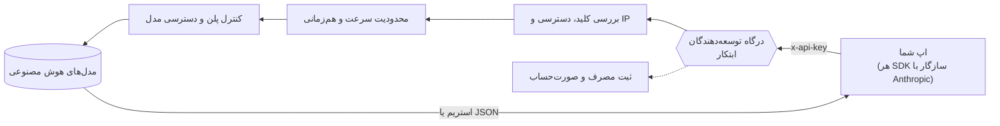

<div align="center">


<br>

[English](README.md) · **فارسی**

<br>

[](https://ebtekarai.ir)
[](docs/developers.fa.md)
[](docs/developers.fa.md)
[](#-محصولات)

</div>

---

<div dir="rtl">

## ✨ ابتکار چیست؟

**ابتکار** یک پلتفرم هوش مصنوعی فارسی است که مدل‌های برتر دنیا را با **یک حساب، یک کیف پول و یک رابط کاربری فارسی** در اختیار شما می‌گذارد؛ از ChatGPT و Claude تا Gemini، Grok، DeepSeek، Kimi و Llama. ابتکار فقط یک چت‌بات نیست: پایتون را در مرورگر خودتان اجرا می‌کند، در وب با منبع و تاریخ جست‌وجو می‌کند، اسنادتان را می‌خواند و نکته‌های مهم گفتگوهایتان را به خاطر می‌سپارد.

> **یک پلتفرم، همهٔ مدل‌های برتر؛ پرداخت ریالی و فقط به اندازهٔ مصرف.**

<br>

## 🧭 قابلیت‌های اصلی

<table>
<tr>
<td width="33%" valign="top">

### 🧠 هاب چندمدلی
بیش از ۷۰ مدل فعال از ۱۲ خانواده: متن، کدنویسی، استدلال، تصویر، ویدئو و صوت. وسط گفتگو هم می‌توانید مدل را عوض کنید.

</td>
<td width="33%" valign="top">

### 🐍 پایتون در مرورگر
پایتون واقعی (Pyodide و WebAssembly) **روی دستگاه خودتان** اجرا می‌شود. با pandas فایل اکسل و CSV را تحلیل کنید و با matplotlib نمودار بکشید. داده‌ها از مرورگر خارج نمی‌شوند.

</td>
<td width="33%" valign="top">

### 🔎 وب‌سرچ مستند
کاوش موازی سریع و عمیق، خواندن کامل صفحه‌ها و پاسخ با لینک و تاریخ منبع؛ بدون ارجاع ساختگی.

</td>
</tr>
<tr>
<td valign="top">

### 📄 اسناد و حافظه
PDF، Word، متن و CSV، همراه با OCR فارسی برای اسناد اسکن‌شده. حافظهٔ پایدار فقط نکته‌های مرتبط را به هر گفتگو می‌آورد.

</td>
<td valign="top">

### 🔌 درگاه توسعه‌دهندگان
یک کلید API برای همهٔ مدل‌های مجاز پلن شما. **سازگار با Anthropic Messages**، پس SDKهای رسمی بدون تغییر کار می‌کنند. استریم، ابزارها و تصویر هم پشتیبانی می‌شوند.

</td>
<td valign="top">

### 💳 پرداخت منصفانه
بدون اشتراک دلاری: پرداخت ریالی و فقط به اندازهٔ مصرف. قیمت هر مدل به ازای یک میلیون توکن نمایش داده و با نرخ لحظه‌ای تبدیل می‌شود.

</td>
</tr>
</table>

<br>

## 🤖 مدل‌ها

</div>

<div align="center">

| | خانواده | کاربرد | | خانواده | کاربرد |
|:-:|---|---|:-:|---|---|
|  | **ChatGPT** | متن · تصویر · صوت |  | **Claude** | نگارش · کدنویسی · تحلیل |
|  | **Gemini** | چندرسانه‌ای · صوت به متن |  | **Grok** | متن · استدلال |
|  | **DeepSeek** | استدلال · کد |  | **Kimi** | متن طولانی · کدنویسی |
|  | **Perplexity** | پاسخ مبتنی بر جست‌وجو |  | **Llama** | متن (وزن‌باز) |
|  | **Nano Banana** | ساخت و ویرایش تصویر |  | **Leonardo** | ساخت تصویر |
|  | **Kling** | ساخت ویدئو |  | **Veo** | ساخت ویدئو |

<sub>دسترسی به هر مدل به پلن شما بستگی دارد. فهرست زنده همیشه در <code>GET /v1/models</code> و روی سایت است.</sub>

</div>

<div dir="rtl">

<br>

## 📦 محصولات

### 🌐 وب‌اپ — [ebtekarai.ir](https://ebtekarai.ir)
کل پلتفرم در مرورگر: چت با همهٔ مدل‌ها، پایتون، وب‌سرچ، اسناد، استودیوی تصویر و ویدئو و موسیقی، و حافظه. روی موبایل هم به‌صورت PWA نصب می‌شود.

### 🖥️ ابتکار برای ویندوز
اپ اختصاصی ویندوز با یک **نوار تعاملی** بالای صفحه و همراهی به اسم **ابتکارک**.

</div>

<div align="center">

&nbsp;&nbsp;

</div>

<div dir="rtl">

- **چت سریع از هر جا:** کلیدهای <kbd>Ctrl</kbd> + <kbd>Alt</kbd> + <kbd>Space</kbd> را بزنید؛ همان حساب و همان تاریخچهٔ وب.
- **فایل را روی نوار رها کنید:** تا ۱۰ فایل در هر بار، به همان چت اضافه می‌شود و تا خودتان نفرستید چیزی ارسال نمی‌شود.
- **همراهی با شخصیت:** کمد لباس با لباس‌های فصلی نوروز و یلدا. همراه را می‌توانید روی دسکتاپ بکشید.
- **خلاصهٔ هفتگی:** فقط روی دستگاه خودتان شمرده می‌شود و متن پیام یا نام فایل ذخیره نمی‌شود.
- **پیش‌نمایش امن تغییرات:** ویرایش فایل و اجرای فرمان در نوار پیش‌نمایش می‌شود و تأیید فقط در پنل امن پروژه انجام می‌شود.

### 🔌 درگاه توسعه‌دهندگان
یک API سازگار با Anthropic جلوی همهٔ مدل‌های ابتکار. مدیریت کلید، محدودیت سرعت، کنترل پلن، مسیریابی و گزارش مصرف را خودش انجام می‌دهد. **← [راهنمای کامل توسعه‌دهندگان](docs/developers.fa.md)**

### ⌨️ ابتکار کد
دستیار کدنویسی در ترمینال. **Claude Code** را هم می‌توانید به درگاه ابتکار وصل کنید؛ بخش [استفاده با Claude Code](docs/developers.fa.md#۱۳-استفاده-با-claude-code) را ببینید.

<br>

## ⚡ شروع سریع برای توسعه‌دهندگان

</div>

```bash
export EBTEKAR_API_KEY="ebt_live_..."   # از ebtekarai.ir/developers بسازید

curl https://ebtekarai.ir/api/developer-gateway/v1/messages \
  -H "x-api-key: $EBTEKAR_API_KEY" \
  -H "anthropic-version: 2023-06-01" \
  -H "content-type: application/json" \
  -d '{
    "model": "ebtekar-smart",
    "max_tokens": 1024,
    "messages": [{"role": "user", "content": "سلام! خودت را معرفی کن."}]
  }'
```

<details>
<summary><b>Python</b></summary>

```python
import os, anthropic

client = anthropic.Anthropic(
    api_key=os.environ["EBTEKAR_API_KEY"],
    base_url="https://ebtekarai.ir/api/developer-gateway",
)
msg = client.messages.create(
    model="ebtekar-smart",
    max_tokens=1024,
    messages=[{"role": "user", "content": "سلام!"}],
)
print(msg.content[0].text)
```
</details>

<details>
<summary><b>JavaScript / TypeScript</b></summary>

```js
import Anthropic from "@anthropic-ai/sdk";

const client = new Anthropic({
  apiKey: process.env.EBTEKAR_API_KEY,
  baseURL: "https://ebtekarai.ir/api/developer-gateway",
});
const msg = await client.messages.create({
  model: "ebtekar-smart",
  max_tokens: 1024,
  messages: [{ role: "user", content: "سلام!" }],
});
console.log(msg.content[0].text);
```
</details>

<div dir="rtl">

نمونه‌های بیشتر در پوشهٔ [`examples/`](examples) و مرجع کامل در [`docs/developers.fa.md`](docs/developers.fa.md) است.

### مسیر یک درخواست

</div>



<div dir="rtl">

<br>

## 🗂️ پلن‌ها

| | رایگان | برنز | نقره | طلایی |
|---|:-:|:-:|:-:|:-:|
| مدل رایگان ابتکار | ✅ | ✅ | ✅ | ✅ |
| مدل‌های سریع (مثل Claude Haiku) | — | ✅ | ✅ | ✅ |
| مدل‌های ردهٔ بالا (مثل GPT-6.1 Sol) | — | — | ✅ | ✅ |
| سقف روزانه | پایه | بیشتر | بیشتر | بیشترین |

<sub>دسترسی دقیق مدل‌ها و سقف‌ها روی سایت نمایش داده می‌شود و ممکن است تغییر کند.</sub>

<br>

## 🔐 امنیت و حریم خصوصی

- کلید API فقط **یک بار** نمایش داده می‌شود و فقط هش امن آن ذخیره می‌شود. کلید گم‌شده قابل بازیابی نیست؛ لغوش کنید و کلید تازه بسازید.
- برای هر کلید می‌توانید سقف درخواست در دقیقه، تعداد هم‌زمان و فهرست IP مجاز تعیین کنید.
- پایتون مرورگر در محیطی ایزوله روی دستگاه خودتان اجرا می‌شود و حافظهٔ هر حساب جداست.
- آسیب‌پذیری پیدا کردید؟ لطفاً [SECURITY.md](SECURITY.md) را بخوانید و issue عمومی باز نکنید.

<br>

## 📁 محتوای این مخزن

</div>

```
.
├── README.md / README.fa.md     ← همین صفحه
├── docs/
│   ├── developers.md            ← راهنمای توسعه‌دهندگان (انگلیسی)
│   └── developers.fa.md         ← راهنمای توسعه‌دهندگان (فارسی)
├── examples/                    ← نمونه‌کدهای آمادهٔ اجرا (curl · Node · Python · PHP)
├── index.html                   ← صفحهٔ معرفی GitHub Pages
├── assets/                      ← لوگو، بنر، آیکون مدل‌ها و تصاویر
└── SECURITY.md
```

<div dir="rtl">

> **توجه:** این مخزن فقط شامل مستندات عمومی و نمونه‌کدهای سمت کاربر است. خود پلتفرم ابتکار متن‌باز **نیست**.

</div>

<br>

<div align="center">


**[ebtekarai.ir](https://ebtekarai.ir)** · [راهنمای توسعه‌دهندگان](docs/developers.fa.md) · [English](README.md)

<sub>ساخته‌شده با علاقه برای سازندگان و توسعه‌دهندگان فارسی‌زبان.</sub>

</div>
