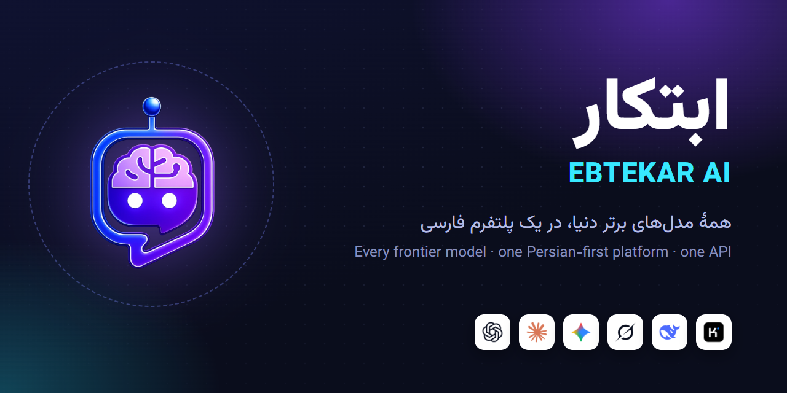
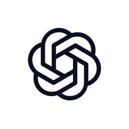
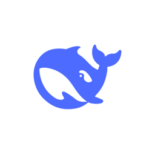
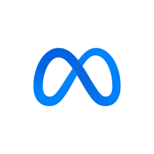
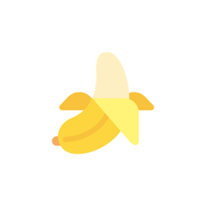
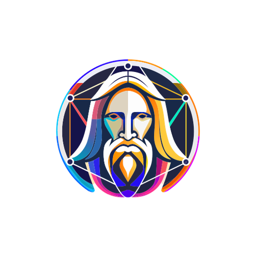
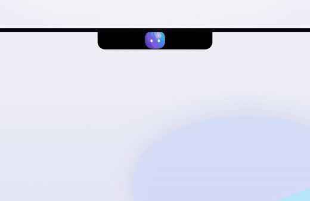
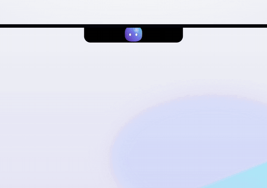
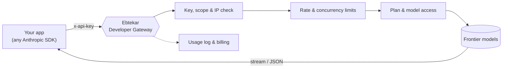

<div align="center">



<br>

**English** · [فارسی](README.fa.md)

<br>

[](https://ebtekarai.ir)
[](docs/developers.md)
[](docs/developers.md#2-authentication)
[](#-products)

</div>

---

## ✨ What is Ebtekar?

**Ebtekar AI** is a Persian-first AI platform. It puts the world's leading models — ChatGPT, Claude, Gemini, Grok, DeepSeek, Kimi, Llama and more — behind **one account, one wallet and one interface in Persian**. Ebtekar is more than a chatbot: it can run Python in your browser, search the web with real citations, read your documents and remember what matters across conversations.

> **One platform. Every frontier model. Paid in Rial, by usage.**

<br>

## 🧭 Highlights

<table>
<tr>
<td width="33%" valign="top">

### 🧠 Multi-model hub
70+ active models from 12 families: text, code, reasoning, image, video and speech. Switch models mid-conversation.

</td>
<td width="33%" valign="top">

### 🐍 Python in the browser
Real Python (Pyodide + WebAssembly) runs **on your device**. Analyze CSV/Excel with pandas and draw charts with matplotlib. Your data never leaves the browser.

</td>
<td width="33%" valign="top">

### 🔎 Cited web search
Parallel quick and deep search branches, full-page reading and answers that cite their sources with links and dates. No made-up references.

</td>
</tr>
<tr>
<td valign="top">

### 📄 Documents & memory
PDF, Word, text and CSV, including Persian OCR for scanned files. Long-term memory brings only the relevant notes into each chat.

</td>
<td valign="top">

### 🔌 Developer Gateway
One API key for every model your plan allows. **Anthropic Messages–compatible**, so the official SDKs work as they are. Streaming, tools and images are supported.

</td>
<td valign="top">

### 💳 Fair billing
No foreign subscriptions: pay in Rial for what you use. Model prices are shown per million tokens and converted at a live rate.

</td>
</tr>
</table>

<br>

## 🤖 Models

<div align="center">

| | Family | What it's for | | Family | What it's for |
|:-:|---|---|:-:|---|---|
|  | **ChatGPT** | text · image · speech |  | **Claude** | writing · coding · analysis |
|  | **Gemini** | multimodal · speech-to-text |  | **Grok** | text · reasoning |
|  | **DeepSeek** | reasoning · code |  | **Kimi** | long context · coding |
|  | **Perplexity** | search-grounded answers |  | **Llama** | open-weight text |
|  | **Nano Banana** | image generation & editing |  | **Leonardo** | image generation |
|  | **Kling** | video generation |  | **Veo** | video generation |

<sub>Availability depends on your plan. The live list is always at <code>GET /v1/models</code> and on the website.</sub>

</div>

<br>

## 📦 Products

### 🌐 Web app — [ebtekarai.ir](https://ebtekarai.ir)
The full platform in your browser: chat with every model, Python, web search, documents, image/video/music studio and memory. Installable on mobile as a PWA.

### 🖥️ Ebtekar for Windows
A native Windows app built around an interactive **island** that sits at the top of your screen and a companion called **Ebtekarak**.

<div align="center">

&nbsp;&nbsp;

</div>

- **Quick chat from anywhere:** press <kbd>Ctrl</kbd> + <kbd>Alt</kbd> + <kbd>Space</kbd>. It uses the same account and history as the web app.
- **Drop files into the island:** up to 10 files per drop, attached to the chat. Nothing is sent until you send it.
- **A companion with personality:** a wardrobe with seasonal outfits for Nowruz and Yalda, and you can drag it onto your desktop.
- **Weekly summary:** counted only on your device. No message text or file names are stored.
- **Safe change previews:** file edits and commands are previewed in the island and approved only in the secure project panel.

### 🔌 Developer Gateway
An Anthropic-compatible API in front of every Ebtekar model. It handles keys, rate limits, plan checks, routing and usage logs. **→ [Read the developer guide](docs/developers.md)**

### ⌨️ Ebtekar Code
A coding assistant for your terminal. You can also point **Claude Code** at Ebtekar's gateway — see [Use with Claude Code](docs/developers.md#13-use-with-claude-code).

<br>

## ⚡ Developer quickstart

```bash
export EBTEKAR_API_KEY="ebt_live_..."   # create one at ebtekarai.ir/developers

curl https://ebtekarai.ir/api/developer-gateway/v1/messages \
  -H "x-api-key: $EBTEKAR_API_KEY" \
  -H "anthropic-version: 2023-06-01" \
  -H "content-type: application/json" \
  -d '{
    "model": "ebtekar-smart",
    "max_tokens": 1024,
    "messages": [{"role": "user", "content": "سلام! خودت را معرفی کن."}]
  }'
```

<details>
<summary><b>Python</b></summary>

```python
import os, anthropic

client = anthropic.Anthropic(
    api_key=os.environ["EBTEKAR_API_KEY"],
    base_url="https://ebtekarai.ir/api/developer-gateway",
)
msg = client.messages.create(
    model="ebtekar-smart",
    max_tokens=1024,
    messages=[{"role": "user", "content": "سلام!"}],
)
print(msg.content[0].text)
```
</details>

<details>
<summary><b>JavaScript / TypeScript</b></summary>

```js
import Anthropic from "@anthropic-ai/sdk";

const client = new Anthropic({
  apiKey: process.env.EBTEKAR_API_KEY,
  baseURL: "https://ebtekarai.ir/api/developer-gateway",
});
const msg = await client.messages.create({
  model: "ebtekar-smart",
  max_tokens: 1024,
  messages: [{ role: "user", content: "سلام!" }],
});
console.log(msg.content[0].text);
```
</details>

More runnable samples are in [`examples/`](examples). The full reference is in [`docs/developers.md`](docs/developers.md).

### How a request flows



<br>

## 🗂️ Plans

| | Free | Bronze | Silver | Gold |
|---|:-:|:-:|:-:|:-:|
| Ebtekar Free model | ✅ | ✅ | ✅ | ✅ |
| Fast frontier models (e.g. Claude Haiku) | — | ✅ | ✅ | ✅ |
| Top-tier models (e.g. GPT-6.1 Sol) | — | — | ✅ | ✅ |
| Daily limits | basic | higher | higher | highest |

<sub>Exact model access and limits are shown on the website and may change.</sub>

<br>

## 🔐 Security & privacy

- API keys are shown **once**. Only a secure hash is stored, so a lost key can't be recovered — revoke it and create a new one.
- Each key can be limited by requests per minute, concurrency and an IP/CIDR allowlist.
- Browser Python runs in a sandbox on your device, and each account's memory is kept separate.
- Found a vulnerability? Please read [SECURITY.md](SECURITY.md). Don't open a public issue.

<br>

## 📁 What's in this repository

```
.
├── README.md / README.fa.md     ← you are here
├── docs/
│   ├── developers.md            ← developer guide (English)
│   └── developers.fa.md         ← developer guide (Persian)
├── examples/                    ← runnable client samples (curl · Node · Python · PHP)
├── index.html                   ← GitHub Pages landing page
├── assets/                      ← logo, banner, model icons, screenshots
└── SECURITY.md
```

> **Note:** This repository contains public documentation and client examples only. The Ebtekar platform itself is **not** open source.

<br>

<div align="center">


**[ebtekarai.ir](https://ebtekarai.ir)** · [Developer guide](docs/developers.md) · [راهنمای فارسی](README.fa.md)

<sub>Made with care for Persian-speaking creators and developers.</sub>

</div>
