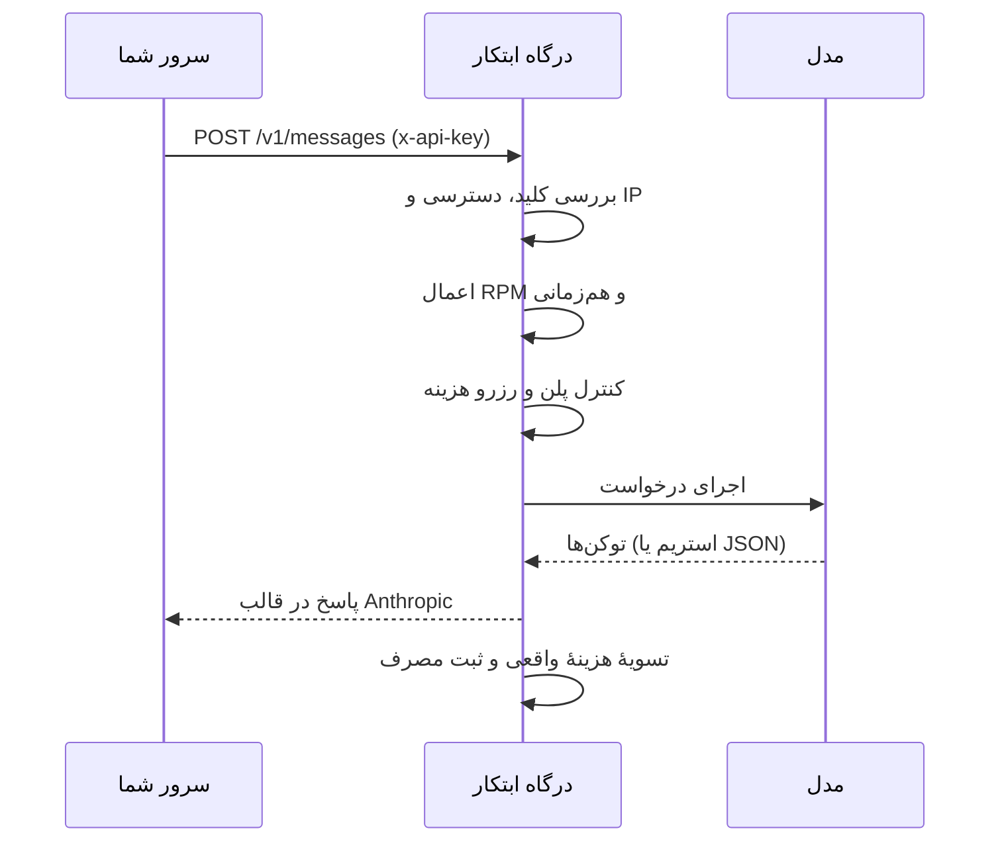

<div align="center">


# راهنمای توسعه‌دهندگان ابتکار

[English](developers.md) · **فارسی**

یک کلید API · همهٔ مدل‌های مجاز پلن شما · سازگار با Anthropic Messages

</div>

---

<div dir="rtl">

## فهرست

1. [معرفی](#۱-معرفی)
2. [احراز هویت](#۲-احراز-هویت)
3. [مسیرها (Endpoints)](#۳-مسیرها-endpoints)
4. [اولین درخواست](#۴-اولین-درخواست)
5. [پارامترهای ارسال پیام](#۵-پارامترهای-ارسال-پیام)
6. [استریم پاسخ](#۶-استریم-پاسخ)
7. [مدل‌ها](#۷-مدلها)
8. [ابزارها و Function Calling](#۸-ابزارها-و-function-calling)
9. [تصویر](#۹-تصویر)
10. [شمارش توکن](#۱۰-شمارش-توکن)
11. [محدودیت‌ها و قیمت](#۱۱-محدودیتها-و-قیمت)
12. [خطاها و تلاش مجدد](#۱۲-خطاها-و-تلاش-مجدد)
13. [استفاده با Claude Code](#۱۳-استفاده-با-claude-code)
14. [چک‌لیست محیط تولید](#۱۴-چکلیست-محیط-تولید)
15. [پرسش‌های رایج](#۱۵-پرسشهای-رایج)

---

## ۱. معرفی

**درگاه توسعه‌دهندگان ابتکار** یک آدرس HTTPS واحد جلوی همهٔ مدل‌های فعال حساب شماست. قالب آن **Anthropic Messages** است؛ پس با SDKهای رسمی Anthropic (پایتون، TypeScript و بقیه) کار می‌کند و فقط کافی است آدرس پایه و کلید را عوض کنید.

| | |
|---|---|
| **آدرس پایه** | `https://ebtekarai.ir/api/developer-gateway` |
| **قالب** | Anthropic Messages (`/v1/messages`) |
| **احراز هویت** | `x-api-key: ebt_live_…` |
| **استریم** | Server-Sent Events (رویدادهای Anthropic) |
| **پنل توسعه‌دهندگان** | [ebtekarai.ir/developers](https://ebtekarai.ir/developers) (کلیدها، مدل‌ها، مصرف، کیف پول) |

هر درخواست این مراحل را طی می‌کند:

</div>



<div dir="rtl">

---

## ۲. احراز هویت

1. در **[ebtekarai.ir/developers](https://ebtekarai.ir/developers)** وارد شوید و به **کلیدهای API ← کلید جدید** بروید.
2. نام، اعتبار (**۳۰ روز، ۹۰ روز یا یک سال**)، سقف درخواست در دقیقه، تعداد هم‌زمان و در صورت نیاز **فهرست IP/CIDR مجاز** را تعیین کنید.
3. کلید را همان لحظه کپی کنید؛ **فقط یک بار نمایش داده می‌شود.** ابتکار فقط هش امن کلید را نگه می‌دارد، پس کلید گم‌شده قابل بازیابی نیست.

این هدرها را با هر درخواست بفرستید:

</div>

```http
x-api-key: ebt_live_YOUR_SECRET_KEY
anthropic-version: 2023-06-01
content-type: application/json
```

<div dir="rtl">

> [!CAUTION]
> کلید را هرگز داخل JavaScript مرورگر، اپ موبایلی که مهندسی معکوس می‌شود یا مخزن Git نگذارید. درگاه را **از سرور خودتان** صدا بزنید و کلید را در متغیر محیطی یا Secret Manager نگه دارید.

---

## ۳. مسیرها (Endpoints)

| متد | مسیر | کاربرد |
|---|---|---|
| `GET` | `/v1/models` | مدل‌های متنی فعال، مجاز برای پلن شما و آمادهٔ استفاده |
| `POST` | `/v1/messages` | ارسال پیام (JSON یا استریم) |
| `POST` | `/v1/messages/count_tokens` | شمارش توکن ورودی پیش از ارسال |

همهٔ مسیرها نسبت به آدرس پایه‌اند؛ مثلاً `https://ebtekarai.ir/api/developer-gateway/v1/messages`.

---

## ۴. اولین درخواست

### cURL

</div>

```bash
curl https://ebtekarai.ir/api/developer-gateway/v1/messages \
  -H "x-api-key: $EBTEKAR_API_KEY" \
  -H "anthropic-version: 2023-06-01" \
  -H "content-type: application/json" \
  -d '{
    "model": "ebtekar-smart",
    "max_tokens": 1024,
    "messages": [{"role": "user", "content": "یک معرفی کوتاه بنویس"}]
  }'
```

<div dir="rtl">

### پایتون — `pip install anthropic`

</div>

```python
import os
import anthropic

client = anthropic.Anthropic(
    api_key=os.environ["EBTEKAR_API_KEY"],
    base_url="https://ebtekarai.ir/api/developer-gateway",
)

message = client.messages.create(
    model="ebtekar-smart",
    max_tokens=1024,
    messages=[{"role": "user", "content": "سلام!"}],
)
print(message.content[0].text)
```

<div dir="rtl">

### جاوااسکریپت / TypeScript — `npm i @anthropic-ai/sdk`

</div>

```js
import Anthropic from "@anthropic-ai/sdk";

const client = new Anthropic({
  apiKey: process.env.EBTEKAR_API_KEY,
  baseURL: "https://ebtekarai.ir/api/developer-gateway",
});

const response = await client.messages.create({
  model: "ebtekar-smart",
  max_tokens: 1024,
  messages: [{ role: "user", content: "سلام!" }],
});
console.log(response.content[0].text);
```

<div dir="rtl">

### PHP

</div>

```php
<?php
$payload = [
  'model' => 'ebtekar-smart',
  'max_tokens' => 1024,
  'messages' => [['role' => 'user', 'content' => 'سلام!']],
];

$ch = curl_init('https://ebtekarai.ir/api/developer-gateway/v1/messages');
curl_setopt_array($ch, [
  CURLOPT_POST => true,
  CURLOPT_RETURNTRANSFER => true,
  CURLOPT_HTTPHEADER => [
    'x-api-key: ' . getenv('EBTEKAR_API_KEY'),
    'anthropic-version: 2023-06-01',
    'content-type: application/json',
  ],
  CURLOPT_POSTFIELDS => json_encode($payload, JSON_UNESCAPED_UNICODE),
]);
echo curl_exec($ch);
```

<div dir="rtl">

پاسخ همان ساختار استاندارد Anthropic را دارد: `content` آرایه‌ای از بلوک‌هاست (برای متن ساده `content[0].text` را بخوانید)، به‌همراه `stop_reason` و شیء `usage` که تعداد توکن ورودی و خروجی را نشان می‌دهد.

---

## ۵. پارامترهای ارسال پیام

| پارامتر | نوع | توضیح |
|---|---|---|
| `model` | string | **الزامی.** دقیقاً یکی از `id`هایی که `GET /v1/models` برمی‌گرداند. |
| `messages` | array | **الزامی.** نوبت‌های `user` و `assistant`؛ `content` رشته یا آرایهٔ بلوک است. |
| `max_tokens` | integer | **الزامی.** سقف خروجی، تا حد مجاز درگاه برای آن مدل. |
| `system` | string \| blocks | دستور سطح سیستم. |
| `stream` | boolean | با `true` پاسخ به‌صورت Server-Sent Events می‌آید. |
| `temperature` | number | اختیاری. بعضی مدل‌ها آن را نادیده می‌گیرند؛ جزئیات مدل را در پنل ببینید. |
| `tools` | array | تعریف ابزار برای مدل‌هایی که ابزار را پشتیبانی می‌کنند. [بخش ۸](#۸-ابزارها-و-function-calling) را ببینید. |

**نمونهٔ گفتگوی چندمرحله‌ای**

</div>

```json
{
  "model": "ebtekar-smart",
  "max_tokens": 800,
  "system": "تو یک دستیار صمیمی هستی و فارسی جواب می‌دهی.",
  "messages": [
    {"role": "user", "content": "یک اسم برای کافه پیشنهاد بده"},
    {"role": "assistant", "content": "«دم‌نوش»؛ کوتاه، گرم و به‌یادماندنی."},
    {"role": "user", "content": "سه گزینهٔ دیگر هم بده"}
  ]
}
```

<div dir="rtl">

---

## ۶. استریم پاسخ

با `"stream": true` درگاه **Server-Sent Events** را با همان رویدادهای Anthropic می‌فرستد (`message_start`، `content_block_delta`، `message_delta`، `message_stop` و…). هر رویداد را جداگانه پردازش کنید و اتصال را تا `message_stop` باز نگه دارید.

**جاوااسکریپت**

</div>

```js
const stream = await client.messages.stream({
  model: "ebtekar-smart",
  max_tokens: 2048,
  messages: [{ role: "user", content: "یک داستان کوتاه بنویس" }],
});

for await (const event of stream) {
  if (event.type === "content_block_delta") {
    process.stdout.write(event.delta.text || "");
  }
}
```

<div dir="rtl">

**پایتون**

</div>

```python
with client.messages.stream(
    model="ebtekar-smart",
    max_tokens=2048,
    messages=[{"role": "user", "content": "یک داستان کوتاه بنویس"}],
) as stream:
    for text in stream.text_stream:
        print(text, end="", flush=True)
```

<div dir="rtl">

> [!NOTE]
> اگر کاربر اتصال را قطع کند، درگاه کار را متوقف می‌کند و درخواست را با وضعیت **cancelled** ثبت می‌کند.

---

## ۷. مدل‌ها

</div>

```bash
curl https://ebtekarai.ir/api/developer-gateway/v1/models \
  -H "x-api-key: $EBTEKAR_API_KEY" \
  -H "anthropic-version: 2023-06-01"
```

<div dir="rtl">

- این مسیر فقط **مدل‌های متنی**‌ای را برمی‌گرداند که فعال، مجاز برای پلن شما و آمادهٔ استفاده‌اند.
- صفحهٔ **مدل‌ها** در پنل کاتالوگ کامل را نشان می‌دهد؛ شامل مدل‌های تصویر، ویدئو و صوت، با قابلیت‌ها، پنجرهٔ محتوا، قیمت دلاری به ازای یک میلیون توکن و وضعیت API هر مدل.
- فهرست را هنگام شروع سرویس برای مدت کوتاهی کش کنید و همیشه `id`ای را بفرستید که همین مسیر برگردانده. فهرست مدل‌ها تغییر می‌کند و شناسهٔ ثابت در کد، دیر یا زود خطا می‌دهد.

---

## ۸. ابزارها و Function Calling

مدل‌هایی که ابزار را پشتیبانی می‌کنند می‌توانند درخواست اجرای ابزاری را بدهند که **شما** تعریف کرده‌اید. درگاه هیچ‌وقت ابزار شما را اجرا نمی‌کند؛ اجرای امن و برگرداندن نتیجه کار سرور شماست.

</div>

```python
tools = [{
    "name": "get_weather",
    "description": "دریافت وضعیت هوای یک شهر",
    "input_schema": {
        "type": "object",
        "properties": {"city": {"type": "string"}},
        "required": ["city"],
    },
}]

messages = [{"role": "user", "content": "هوای تهران الان چطوره؟"}]
resp = client.messages.create(model="ebtekar-smart", max_tokens=1024, tools=tools, messages=messages)

while resp.stop_reason == "tool_use":
    messages.append({"role": "assistant", "content": resp.content})
    results = []
    for block in resp.content:
        if block.type == "tool_use" and block.name == "get_weather":
            data = my_weather_lookup(block.input["city"])        # کد خودتان، با اعتبارسنجی
            results.append({"type": "tool_result", "tool_use_id": block.id, "content": data})
    messages.append({"role": "user", "content": results})
    resp = client.messages.create(model="ebtekar-smart", max_tokens=1024, tools=tools, messages=messages)

print(resp.content[0].text)
```

<div dir="rtl">

**قواعد امنیتی**
- ورودی ابزار را دوباره با JSON Schema و قواعد کسب‌وکار خودتان اعتبارسنجی کنید.
- برای پرداخت، حذف داده و هر کار برگشت‌ناپذیر، تأیید انسانی بگیرید.
- خروجی ابزار را دادهٔ غیرقابل‌اعتماد در نظر بگیرید.

---

## ۹. تصویر

مدلی را انتخاب کنید که قابلیت تصویرش در `/v1/models` یا پنل `true` باشد. بعد یک بلوک تصویر base64 استاندارد بفرستید:

</div>

```json
{
  "role": "user",
  "content": [
    {"type": "image", "source": {"type": "base64", "media_type": "image/jpeg", "data": "<BASE64>"}},
    {"type": "text", "text": "این تصویر را تحلیل کن"}
  ]
}
```

<div dir="rtl">

> [!TIP]
> فایل‌های بزرگ را در فضای ذخیره‌سازی امن خودتان نگه دارید و کلید API یا URL امضاشده را هرگز در لاگ عمومی ننویسید.

---

## ۱۰. شمارش توکن

پیش از ارسال، حجم درخواست را تخمین بزنید:

</div>

```bash
curl https://ebtekarai.ir/api/developer-gateway/v1/messages/count_tokens \
  -H "x-api-key: $EBTEKAR_API_KEY" \
  -H "anthropic-version: 2023-06-01" \
  -H "content-type: application/json" \
  -d '{"model": "ebtekar-smart", "messages": [{"role": "user", "content": "سلام!"}]}'
```

```python
count = client.messages.count_tokens(model="ebtekar-smart", messages=[{"role": "user", "content": "سلام!"}])
print(count.input_tokens)
```

<div dir="rtl">

---

## ۱۱. محدودیت‌ها و قیمت

**صورت‌حساب چطور کار می‌کند**

1. **کیف پول تومانی** را از پنل شارژ کنید. پرداخت فقط بعد از تأیید سمت سرور ثبت می‌شود.
2. قیمت مدل‌ها به **دلار و به ازای یک میلیون توکن ورودی و خروجی** نمایش داده می‌شود.
3. پیش از اجرای درخواست، درگاه حداکثر هزینهٔ آن را با نرخ کوتاه‌عمر دلار **رزرو** می‌کند.
4. بعد از پاسخ، هزینه بر اساس توکن **واقعی** ورودی و خروجی کسر و بقیهٔ رزرو آزاد می‌شود.
5. اگر درخواست پیش از تکمیل به‌خاطر خطای زیرساخت شکست بخورد، رزرو آزاد می‌شود.
6. مدل‌هایی که قیمت توکنی ندارند قیمت ثابت به ازای هر درخواست دارند که در جزئیات مدل نمایش داده می‌شود.

**محدودیت پیش‌فرض هر کلید**

| محدودیت | پیش‌فرض | حداکثر |
|---|---|---|
| درخواست در دقیقه (RPM) | ۲۴ | قابل تنظیم برای هر کلید |
| درخواست هم‌زمان | ۲ | ۳ |

---

## ۱۲. خطاها و تلاش مجدد

| کد | معنی | تلاش مجدد؟ |
|---|---|---|
| `400` | بدنه یا پارامتر نامعتبر | ❌ اول درخواست را اصلاح کنید |
| `401` | کلید نامعتبر یا منقضی | ❌ |
| `402` | موجودی کافی نیست | ❌ اول شارژ کنید |
| `403` | مدل، دسترسی یا IP برای این کلید مجاز نیست | ❌ |
| `409` | `Idempotency-Key` تکراری | ❌ |
| `429` | محدودیت سرعت یا هم‌زمانی | ✅ با backoff |
| `5xx` | خطای موقت زیرساخت | ✅ با backoff و jitter |

**تلاش مجدد با backoff نمایی و jitter (پایتون)**

</div>

```python
import random, time
import anthropic

def create_with_retry(client, max_attempts=5, **kwargs):
    for attempt in range(max_attempts):
        try:
            return client.messages.create(**kwargs)
        except anthropic.APIStatusError as e:
            if e.status_code != 429 and e.status_code < 500:
                raise                                   # خطای سمت کاربر را تکرار نکن
            if attempt == max_attempts - 1:
                raise
            delay = min(30, 0.5 * 2 ** attempt) + random.uniform(0, 0.3)
            time.sleep(delay)
```

<div dir="rtl">

**ردیابی و جلوگیری از تکرار**
- هدر `x-request-id` پاسخ را در لاگ خود ذخیره کنید تا شما و پشتیبانی ابتکار بتوانید درخواست را پیدا کنید.
- برای هر درخواست منطقی یک هدر `Idempotency-Key` یکتا بفرستید تا تلاش مجدد هیچ‌وقت دو بار هزینه نشود.

---

## ۱۳. استفاده با Claude Code

چون درگاه به قالب Anthropic صحبت می‌کند، **Claude Code** می‌تواند با مدل‌های ابتکار کار کند:

**ویندوز (PowerShell)**

</div>

```powershell
$env:ANTHROPIC_BASE_URL="https://ebtekarai.ir/api/developer-gateway"
$env:ANTHROPIC_AUTH_TOKEN="ebt_live_YOUR_SECRET_KEY"
claude
```

<div dir="rtl">

**macOS / لینوکس**

</div>

```bash
export ANTHROPIC_BASE_URL="https://ebtekarai.ir/api/developer-gateway"
export ANTHROPIC_AUTH_TOKEN="ebt_live_YOUR_SECRET_KEY"
claude
```

<div dir="rtl">

دستیار ترمینال خود ابتکار را ترجیح می‌دهید؟ بعد از ورود، صفحهٔ **ابتکار کد** را روی سایت ببینید.

---

## ۱۴. چک‌لیست محیط تولید

- [ ] کلید را فقط در Secret Manager یا متغیر محیطی سرور نگه دارید.
- [ ] برای staging و production **کلید جدا** بسازید و برای هر سرویس یک کلید.
- [ ] **فهرست IP مجاز** را فعال کنید، RPM معقول بگذارید و کمترین دسترسی لازم را بدهید.
- [ ] با هر درخواست یک `Idempotency-Key` یکتا بفرستید.
- [ ] Timeout و لغو درخواست بگذارید و فقط `429` و `5xx` را با تعداد محدود تکرار کنید.
- [ ] `x-request-id` را لاگ کنید، ولی کلید، پرامپت حاوی اطلاعات شخصی یا URL امضاشده را **هرگز** لاگ نکنید.
- [ ] اگر کلید لو رفت، **فوراً از پنل لغوش کنید** و کلید تازه بسازید.

---

## ۱۵. پرسش‌های رایج

<details>
<summary><b>قالب OpenAI (<code>/chat/completions</code>) پشتیبانی می‌شود؟</b></summary>

خیر. درگاه عمومی قالب **Anthropic Messages** (`/v1/messages`) را دارد. از SDKهای Anthropic استفاده کنید یا همان JSON بالا را با هر کلاینت HTTP بفرستید.
</details>

<details>
<summary><b>از کدام شناسهٔ مدل استفاده کنم؟</b></summary>

یکی از شناسه‌هایی که `GET /v1/models` برای کلید شما برگردانده. اگر پلنتان شامل `ebtekar-smart` است، گزینهٔ پیش‌فرض خوبی است.
</details>

<details>
<summary><b>می‌توانم API را مستقیم از صفحهٔ وب صدا بزنم؟</b></summary>

خیر، چون کلیدتان لو می‌رود. یک سرور کوچک وسط بگذارید که کلید را نگه دارد و محدودیت‌های کاربران خودتان را اعمال کند.
</details>

<details>
<summary><b>مصرف و هزینه را کجا ببینم؟</b></summary>

در پنل، بخش **مصرف و لاگ**: وضعیت، زمان پاسخ، زمان رسیدن اولین بایت، مدل، حجم ورودی و خروجی و هزینهٔ تخمینی برای ۷، ۳۰ یا ۹۰ روز گذشته.
</details>

</div>

---

<div align="center">
<sub>© Ebtekar AI · <a href="https://ebtekarai.ir">ebtekarai.ir</a> · <a href="../README.fa.md">بازگشت به صفحهٔ اصلی</a></sub>
</div>
