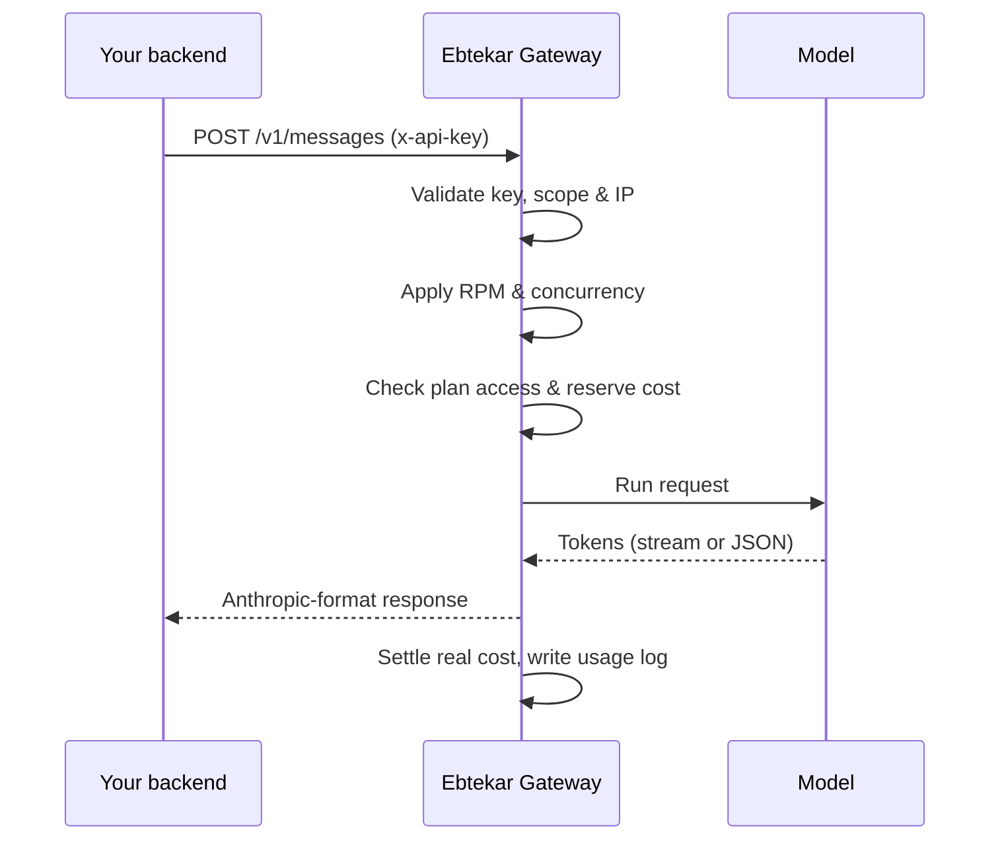

<div align="center">


# Ebtekar Developer Guide

**English** · [فارسی](developers.fa.md)

One API key · every model your plan allows · Anthropic Messages–compatible

</div>

---

## Contents

1. [Overview](#1-overview)
2. [Authentication](#2-authentication)
3. [Endpoints](#3-endpoints)
4. [Your first request](#4-your-first-request)
5. [Messages parameters](#5-messages-parameters)
6. [Streaming](#6-streaming)
7. [Models](#7-models)
8. [Tools & function calling](#8-tools--function-calling)
9. [Images](#9-images)
10. [Counting tokens](#10-counting-tokens)
11. [Limits & pricing](#11-limits--pricing)
12. [Errors & retries](#12-errors--retries)
13. [Use with Claude Code](#13-use-with-claude-code)
14. [Production checklist](#14-production-checklist)
15. [FAQ](#15-faq)

---

## 1. Overview

The **Ebtekar Developer Gateway** is one HTTPS endpoint in front of every active model on your account. It speaks the **Anthropic Messages** format, so you can use the official Anthropic SDKs (Python, TypeScript and others) by changing only the base URL and the key.

| | |
|---|---|
| **Base URL** | `https://ebtekarai.ir/api/developer-gateway` |
| **Format** | Anthropic Messages (`/v1/messages`) |
| **Auth** | `x-api-key: ebt_live_…` |
| **Streaming** | Server-Sent Events (Anthropic event types) |
| **Developer portal** | [ebtekarai.ir/developers](https://ebtekarai.ir/developers) (keys, models, usage, wallet) |

Every request goes through these steps:



---

## 2. Authentication

1. Sign in at **[ebtekarai.ir/developers](https://ebtekarai.ir/developers)** and open **API keys → New key**.
2. Choose a name, a lifetime (**30 days, 90 days or 1 year**), requests per minute, concurrency and, optionally, an **IP/CIDR allowlist**.
3. Copy the key right away. **It is shown only once.** Ebtekar stores only a secure hash, so a lost key can't be recovered.

Send these headers with every request:

```http
x-api-key: ebt_live_YOUR_SECRET_KEY
anthropic-version: 2023-06-01
content-type: application/json
```

> [!CAUTION]
> Never put the key in browser JavaScript, a mobile app that can be reverse-engineered, or a Git repository. Call the gateway **from your backend** and keep the key in an environment variable or a secret manager.

---

## 3. Endpoints

| Method | Path | Purpose |
|---|---|---|
| `GET` | `/v1/models` | Text models that are active, allowed for your plan and ready to use |
| `POST` | `/v1/messages` | Create a message (JSON or streaming) |
| `POST` | `/v1/messages/count_tokens` | Count input tokens before sending |

All paths are relative to the base URL, for example `https://ebtekarai.ir/api/developer-gateway/v1/messages`.

---

## 4. Your first request

### cURL

```bash
curl https://ebtekarai.ir/api/developer-gateway/v1/messages \
  -H "x-api-key: $EBTEKAR_API_KEY" \
  -H "anthropic-version: 2023-06-01" \
  -H "content-type: application/json" \
  -d '{
    "model": "ebtekar-smart",
    "max_tokens": 1024,
    "messages": [{"role": "user", "content": "یک معرفی کوتاه بنویس"}]
  }'
```

### Python — `pip install anthropic`

```python
import os
import anthropic

client = anthropic.Anthropic(
    api_key=os.environ["EBTEKAR_API_KEY"],
    base_url="https://ebtekarai.ir/api/developer-gateway",
    default_headers={"User-Agent": "Ebtekar-Client/1.0"},
)

message = client.messages.create(
    model="ebtekar-smart",
    max_tokens=1024,
    messages=[{"role": "user", "content": "سلام!"}],
)
print(message.content[0].text)
```

### JavaScript / TypeScript — `npm i @anthropic-ai/sdk`

```js
import Anthropic from "@anthropic-ai/sdk";

const client = new Anthropic({
  apiKey: process.env.EBTEKAR_API_KEY,
  baseURL: "https://ebtekarai.ir/api/developer-gateway",
});

const response = await client.messages.create({
  model: "ebtekar-smart",
  max_tokens: 1024,
  messages: [{ role: "user", content: "سلام!" }],
});
console.log(response.content[0].text);
```

### PHP

```php
<?php
$payload = [
  'model' => 'ebtekar-smart',
  'max_tokens' => 1024,
  'messages' => [['role' => 'user', 'content' => 'سلام!']],
];

$ch = curl_init('https://ebtekarai.ir/api/developer-gateway/v1/messages');
curl_setopt_array($ch, [
  CURLOPT_POST => true,
  CURLOPT_RETURNTRANSFER => true,
  CURLOPT_HTTPHEADER => [
    'x-api-key: ' . getenv('EBTEKAR_API_KEY'),
    'anthropic-version: 2023-06-01',
    'content-type: application/json',
  ],
  CURLOPT_POSTFIELDS => json_encode($payload, JSON_UNESCAPED_UNICODE),
]);
echo curl_exec($ch);
```

The response uses the standard Anthropic shape: `content` is an array of blocks (read `content[0].text` for plain text), with `stop_reason` and a `usage` object holding input and output token counts.

---

## 5. Messages parameters

| Parameter | Type | Notes |
|---|---|---|
| `model` | string | **Required.** Use an exact `id` returned by `GET /v1/models`. |
| `messages` | array | **Required.** Alternating `user` / `assistant` turns. `content` is a string or an array of blocks. |
| `max_tokens` | integer | **Required.** Output cap, up to the gateway's limit for the model. |
| `system` | string \| blocks | System-level instructions. |
| `stream` | boolean | `true` returns Server-Sent Events. |
| `temperature` | number | Optional. Some models ignore it; check the model details in the portal. |
| `tools` | array | Tool definitions for models with tool support. See [§8](#8-tools--function-calling). |

**Multi-turn example**

```json
{
  "model": "ebtekar-smart",
  "max_tokens": 800,
  "system": "You are a friendly assistant. Answer in Persian.",
  "messages": [
    {"role": "user", "content": "یک اسم برای کافه پیشنهاد بده"},
    {"role": "assistant", "content": "«دم‌نوش»؛ کوتاه، گرم و به‌یادماندنی."},
    {"role": "user", "content": "سه گزینهٔ دیگر هم بده"}
  ]
}
```

---

## 6. Streaming

With `"stream": true` the gateway sends **Server-Sent Events** using the Anthropic event types (`message_start`, `content_block_delta`, `message_delta`, `message_stop`, …). Handle each event on its own, and keep the connection open until `message_stop`.

**JavaScript**

```js
const stream = await client.messages.stream({
  model: "ebtekar-smart",
  max_tokens: 2048,
  messages: [{ role: "user", content: "یک داستان کوتاه بنویس" }],
});

for await (const event of stream) {
  if (event.type === "content_block_delta") {
    process.stdout.write(event.delta.text || "");
  }
}
```

**Python**

```python
with client.messages.stream(
    model="ebtekar-smart",
    max_tokens=2048,
    messages=[{"role": "user", "content": "یک داستان کوتاه بنویس"}],
) as stream:
    for text in stream.text_stream:
        print(text, end="", flush=True)
```

> [!NOTE]
> If the client disconnects, the gateway stops the work and logs the request as **cancelled**.

---

## 7. Models

```bash
curl https://ebtekarai.ir/api/developer-gateway/v1/models \
  -H "x-api-key: $EBTEKAR_API_KEY" \
  -H "anthropic-version: 2023-06-01"
```

- This endpoint returns only **text models** that are active, allowed for your plan and ready to use.
- The **Models** page in the portal shows the full catalog, including image, video and audio models, their capabilities, context window, USD price per 1M tokens and their API status.
- Cache the list for a short time when your service starts, and always send an `id` that this endpoint returned. Model lineups change, and hard-coded IDs break.

---

## 8. Tools & function calling

Models with tool support can ask to call tools that **you** define. The gateway never runs your tools. Running them safely and returning the result is your server's job.

```python
tools = [{
    "name": "get_weather",
    "description": "Get the current weather for a city",
    "input_schema": {
        "type": "object",
        "properties": {"city": {"type": "string"}},
        "required": ["city"],
    },
}]

messages = [{"role": "user", "content": "هوای تهران الان چطوره؟"}]
resp = client.messages.create(model="ebtekar-smart", max_tokens=1024, tools=tools, messages=messages)

while resp.stop_reason == "tool_use":
    messages.append({"role": "assistant", "content": resp.content})
    results = []
    for block in resp.content:
        if block.type == "tool_use" and block.name == "get_weather":
            data = my_weather_lookup(block.input["city"])        # your own, validated code
            results.append({"type": "tool_result", "tool_use_id": block.id, "content": data})
    messages.append({"role": "user", "content": results})
    resp = client.messages.create(model="ebtekar-smart", max_tokens=1024, tools=tools, messages=messages)

print(resp.content[0].text)
```

**Safety rules**
- Validate tool input again against your JSON Schema and your own business rules.
- Require human approval for payments, deletions and other irreversible actions.
- Treat tool output as untrusted data.

---

## 9. Images

Choose a model whose image capability is `true` in `/v1/models` or in the portal. Then send a standard base64 image block:

```json
{
  "role": "user",
  "content": [
    {"type": "image", "source": {"type": "base64", "media_type": "image/jpeg", "data": "<BASE64>"}},
    {"type": "text", "text": "این تصویر را تحلیل کن"}
  ]
}
```

> [!TIP]
> Keep large files in your own secure storage. Never write API keys or signed URLs into public logs.

---

## 10. Counting tokens

Estimate the size of a request before you send it:

```bash
curl https://ebtekarai.ir/api/developer-gateway/v1/messages/count_tokens \
  -H "x-api-key: $EBTEKAR_API_KEY" \
  -H "anthropic-version: 2023-06-01" \
  -H "content-type: application/json" \
  -d '{"model": "ebtekar-smart", "messages": [{"role": "user", "content": "سلام!"}]}'
```

```python
count = client.messages.count_tokens(model="ebtekar-smart", messages=[{"role": "user", "content": "سلام!"}])
print(count.input_tokens)
```

---

## 11. Limits & pricing

**How billing works**

1. Top up your **wallet in Toman** in the portal. A payment is credited only after the server verifies it.
2. Model prices are listed in **USD per 1M input/output tokens**.
3. Before a request runs, the gateway **reserves** its maximum cost at a short-lived USD rate.
4. After the response, the **real** input and output tokens are charged and the rest of the reservation is released.
5. If a request fails because of an infrastructure error before it finishes, the reservation is released.
6. Models without per-token pricing use a fixed per-request price, shown in the model details.

**Default limits per key**

| Limit | Default | Maximum |
|---|---|---|
| Requests per minute (RPM) | 24 | set per key |
| Concurrent requests | 2 | 3 |

---

## 12. Errors & retries

| Status | Meaning | Retry? |
|---|---|---|
| `400` | Invalid body or parameter | ❌ Fix the request first |
| `401` | Invalid or expired key | ❌ |
| `402` | Not enough balance | ❌ Top up first |
| `403` | Model, scope or IP not allowed for this key | ❌ |
| `409` | Duplicate `Idempotency-Key` | ❌ |
| `429` | Rate or concurrency limit | ✅ with backoff |
| `5xx` | Temporary infrastructure error | ✅ with backoff + jitter |

**Retry with exponential backoff and jitter (Python)**

```python
import random, time
import anthropic

def create_with_retry(client, max_attempts=5, **kwargs):
    for attempt in range(max_attempts):
        try:
            return client.messages.create(**kwargs)
        except anthropic.APIStatusError as e:
            if e.status_code != 429 and e.status_code < 500:
                raise                                   # don't retry client errors
            if attempt == max_attempts - 1:
                raise
            delay = min(30, 0.5 * 2 ** attempt) + random.uniform(0, 0.3)
            time.sleep(delay)
```

**Tracing and idempotency**
- Store the `x-request-id` response header in your logs. It lets you and Ebtekar support find a request.
- Send a unique `Idempotency-Key` header per logical request, so a retried request is never charged twice.

---

## 13. Use with Claude Code

Because the gateway speaks the Anthropic format, **Claude Code** can run on Ebtekar's models:

**Windows (PowerShell)**

```powershell
$env:ANTHROPIC_BASE_URL="https://ebtekarai.ir/api/developer-gateway"
$env:ANTHROPIC_AUTH_TOKEN="ebt_live_YOUR_SECRET_KEY"
claude
```

**macOS / Linux**

```bash
export ANTHROPIC_BASE_URL="https://ebtekarai.ir/api/developer-gateway"
export ANTHROPIC_AUTH_TOKEN="ebt_live_YOUR_SECRET_KEY"
claude
```

Prefer Ebtekar's own terminal assistant? See the **Ebtekar Code** page on the website after you sign in.

---

## 14. Production checklist

- [ ] Keep the key only in a backend secret manager or environment variable.
- [ ] Use **separate keys** for staging and production, and one key per service.
- [ ] Turn on an **IP allowlist**, set a sensible RPM, and grant the smallest scope you need.
- [ ] Send a unique `Idempotency-Key` with every request.
- [ ] Add timeouts and cancellation, and retry only `429` and `5xx`, a limited number of times.
- [ ] Log `x-request-id`, but **never** log keys, prompts holding personal data, or signed URLs.
- [ ] If a key leaks, **revoke it in the portal immediately** and issue a new one.

---

## 15. FAQ

<details>
<summary><b>Is the OpenAI <code>/chat/completions</code> format supported?</b></summary>

No. The public gateway uses the **Anthropic Messages** format (`/v1/messages`). Use an Anthropic SDK, or send the JSON shown above from any HTTP client.
</details>

<details>
<summary><b>Why do the Python samples set a custom <code>User-Agent</code>?</b></summary>

Some hosting firewalls reject requests whose User-Agent contains the word `python`, and the Python SDK's default is `Anthropic/Python …`. Setting `default_headers={"User-Agent": "Ebtekar-Client/1.0"}` avoids an unexpected `403`. It's harmless, so keep it in your code.
</details>

<details>
<summary><b>Which model ID should I use?</b></summary>

Use one that `GET /v1/models` returned for your key. `ebtekar-smart` is a good general default if your plan includes it.
</details>

<details>
<summary><b>Can I call the API directly from a web page?</b></summary>

No. That would expose your key. Put a small backend in between that holds the key and applies your own user limits.
</details>

<details>
<summary><b>Where can I see usage and cost?</b></summary>

In the portal under **Usage & logs**: status, latency, time to first byte, model, input/output size and estimated cost for the last 7, 30 or 90 days.
</details>

---

<div align="center">
<sub>© Ebtekar AI · <a href="https://ebtekarai.ir">ebtekarai.ir</a> · <a href="../README.md">Back to README</a></sub>
</div>
